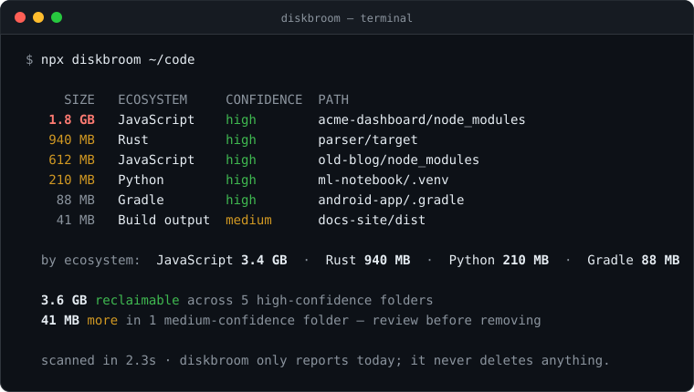

# diskbroom

> Find and reclaim the gigabytes of regenerable build junk rotting across all your projects — safely, on any OS.

[](https://www.npmjs.com/package/diskbroom)
[](./LICENSE)
[](https://nodejs.org)

Every developer's disk is quietly bleeding space to `node_modules`, `.venv`,
`target/`, `.gradle`, and a dozen build caches — all of it perfectly
regenerable with a single command. **diskbroom** walks your projects, adds it
all up, shows you exactly where the space went, and — only if you ask — lets
you pick folders to delete.

<p align="center">
  
</p>

## Why diskbroom?

Good cleaners already exist: [npkill](https://github.com/voidcosmos/npkill) is great for `node_modules`, and [kondo](https://github.com/tbillington/kondo) covers many ecosystems. diskbroom's focus is being safe to point at a whole disk:

- **Report first, delete second** — read-only by default. Deleting needs `--interactive --delete`, your own selection and a typed `yes`, and every folder is re-checked right before it's removed: anything behind a symlink, inside a protected folder or installed software, or containing git-tracked files is refused.
- **Knows what isn't yours** — never follows symlinks and never descends into version-control internals, Windows system folders, installed packages and apps, editor extensions or tool caches, so it won't offer up npm's own global install or a VS Code extension.
- **Precise** — ambiguous names like `target/`, `dist/` and `bin/` only count when a project marker (e.g. `Cargo.toml`, `package.json`, a `.csproj`) sits next to them, and every finding carries a confidence level, so your hand-written `build/` folder is left alone.
- **Nothing to install** — `npx diskbroom` runs anywhere Node does, with zero runtime dependencies (nothing sketchy in your `node_modules` — ironic, we know).
- **Cross-ecosystem, cross-platform** — JavaScript, Python, Rust, Java/Gradle, .NET, Terraform and more in one pass, built and tested on Windows, macOS and Linux.

## Install

Run it once without installing:

```bash
npx diskbroom
```

Or install globally:

```bash
npm install -g diskbroom
```

## Usage

```bash
diskbroom [path] [options]
```

| Option | Description |
| --- | --- |
| `path` | Directory to scan (default: current directory) |
| `-i, --interactive` | Pick folders from the results to remove — a dry run unless `--delete` is also given |
| `--delete` | With `-i`: really delete the picked folders, after you type `yes` to confirm |
| `--top <n>` | Show only the *n* largest findings |
| `--depth <n>` | Limit how deep to descend |
| `--json` | Output machine-readable JSON |
| `--verbose` | List unreadable paths and their filesystem error codes |
| `-h, --help` | Show help |
| `-v, --version` | Show version |

### Examples

```bash
diskbroom                     # scan the current folder
diskbroom ~/code --top 20     # 20 biggest artifacts under ~/code
diskbroom . --json            # JSON output for scripts or CI
diskbroom ~/code -i           # pick folders, preview the space you'd free (dry run)
diskbroom ~/code -i --delete  # pick folders, confirm, then delete them
```

If a directory cannot be listed or a file cannot be measured, the scan continues
and warns that totals may be incomplete. Use `--verbose` for the affected paths
and error codes (for example, `EACCES` or `ENOENT`). JSON output includes
`errorCount` and an `errors` array of `{ path, code }` entries alongside `findings`.
Each affected path is reported once, even if it was checked more than once.

### Interactive cleanup

With `-i`, diskbroom numbers the results and asks which ones you want gone:

```text
  #       SIZE  ECOSYSTEM     CONFIDENCE  PATH
  1     1.2 GB  JavaScript    high        webapp/node_modules
  2     840 MB  Rust          high        cli/target
  3    41.0 MB  Build output  medium      site/dist

  Select folders to delete (e.g. 1,3,5-7 · all · high · Enter to cancel): 1-2
```

- Pick with numbers and ranges (`1,3,5-7`), `all`, or `high` for every
  high-confidence folder. Press Enter to cancel. With `--top`, the numbers
  refer to the rows shown.
- **Without `--delete` it is a dry run**: you see exactly which folders would
  go and how much space you'd get back, and nothing is touched.
- **With `--delete`** diskbroom asks you to type `yes` (a bare `y` won't do).
  Any other answer, Ctrl+C, or end of input cancels. Deletion is permanent —
  folders are not moved to the Trash — so everything must be regenerable,
  which is exactly what diskbroom looks for.

Right before each folder is deleted, diskbroom checks it again. It is skipped
(and reported) if it is no longer inside the scanned path, if it or any folder
above it has turned into a symlink or junction, if it sits inside a protected
system or VCS folder or inside installed software, if it no longer matches its rule
(say, the `Cargo.toml` next to `target/` is gone), or if git tracks files inside
it (like a GitHub Action's committed `dist/`; checked whenever git is
installed). Symlinks *inside* a deleted folder are removed as links; whatever
they point to is never touched.

## What it detects

| Ecosystem | Folders |
| --- | --- |
| JavaScript | `node_modules` and `coverage` (next to a `package.json` or `deno.json`), `.next`, `.nuxt`, `.svelte-kit`, `.turbo`, `.parcel-cache`, `.angular` |
| Python | `.venv`, `venv`, `__pycache__`, `.mypy_cache`, `.pytest_cache`, `.ruff_cache`, `.tox` |
| Rust | `target` (next to a `Cargo.toml`) |
| Java / Gradle | `.gradle` (next to a Gradle build or settings file) |
| .NET | `bin`, `obj` (next to a project/solution file) |
| Build output | `dist`, `build` (next to a project manifest) |
| Terraform | `.terraform` |

diskbroom never looks inside installed software or caches: `site-packages`,
Node's global `lib/node_modules`, `~/.cache`, the Gradle user home `~/.gradle`,
macOS `.app` bundles, Electron apps' packaged `resources/app`, or editor
extensions (`~/.vscode/extensions`, `~/.vscode-server`, `~/.cursor`). Anything
in there belongs to an installed tool, not to your projects, and reinstalling
dependencies won't bring it back.

Missing something? [Open an issue](https://github.com/EfeHasNoLuck/diskbroom/issues) — the catalogue is easy to extend in [`src/patterns.ts`](./src/patterns.ts).

## Confidence levels

- **high** — the folder is unambiguous and always regenerable. Counted in the headline total.
- **medium** — the folder *name* could theoretically hold source, so diskbroom only flags it when a project marker is present, and reports it separately for you to review.

## Roadmap

- [x] Interactive mode — select folders and delete them (dry-run by default, `--delete` + typed confirmation)
- [ ] `--older-than 30d` to target only stale artifacts
- [ ] Config file for custom rules and ignore paths
- [ ] Package-manager cache cleanup (npm, pip, cargo, Gradle global caches)

## Contributing

Issues and PRs are very welcome — especially new ecosystem rules. See
[`src/patterns.ts`](./src/patterns.ts) for how detection works.

```bash
git clone https://github.com/EfeHasNoLuck/diskbroom
cd diskbroom
npm install
npm test
npm run build
node dist/cli.js --help
```

## License

[MIT](./LICENSE) © Efe Saygılı
